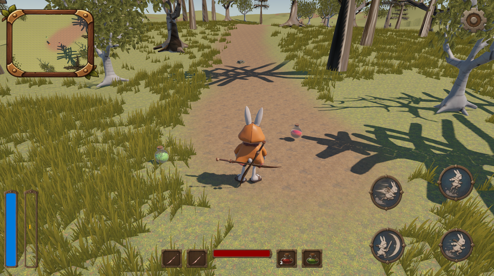
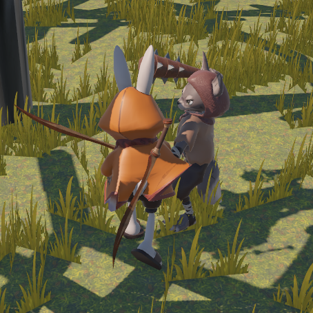
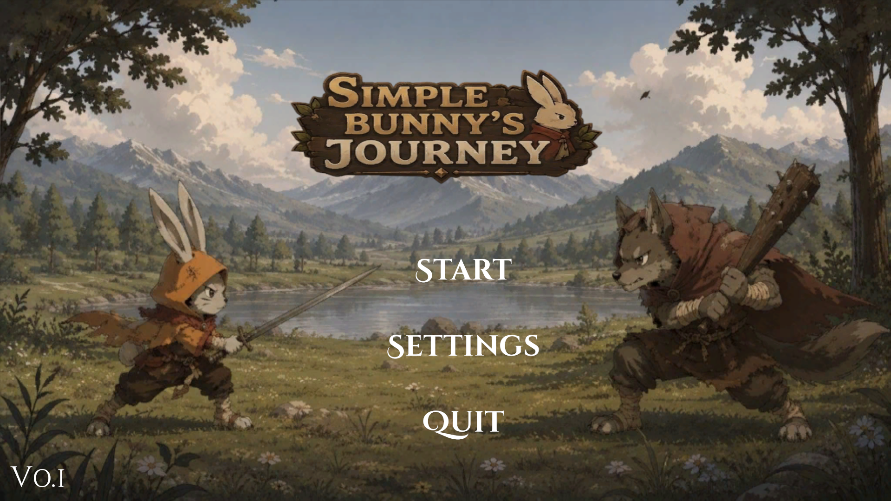
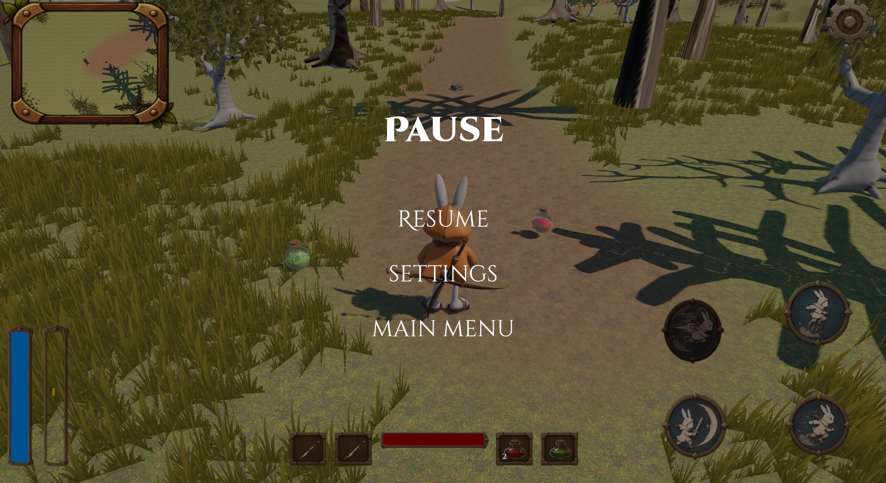
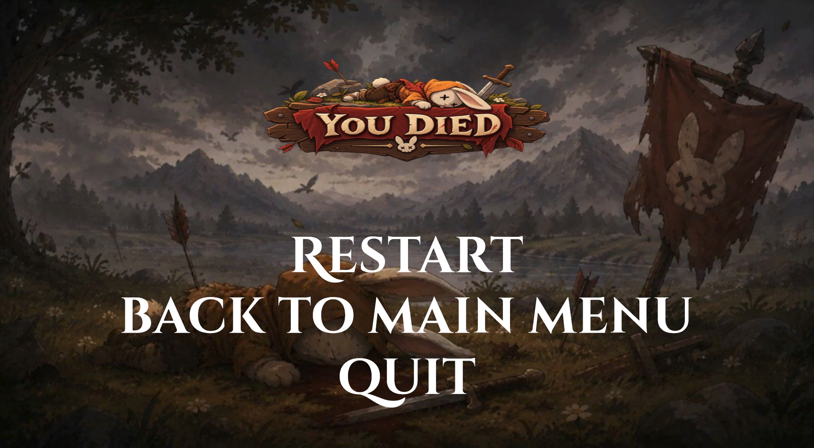
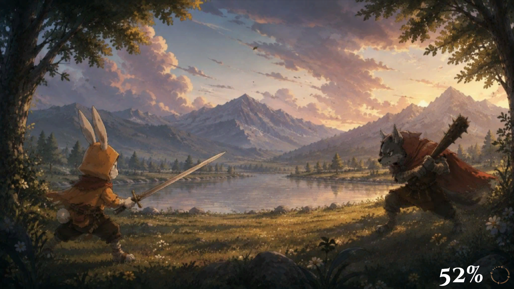
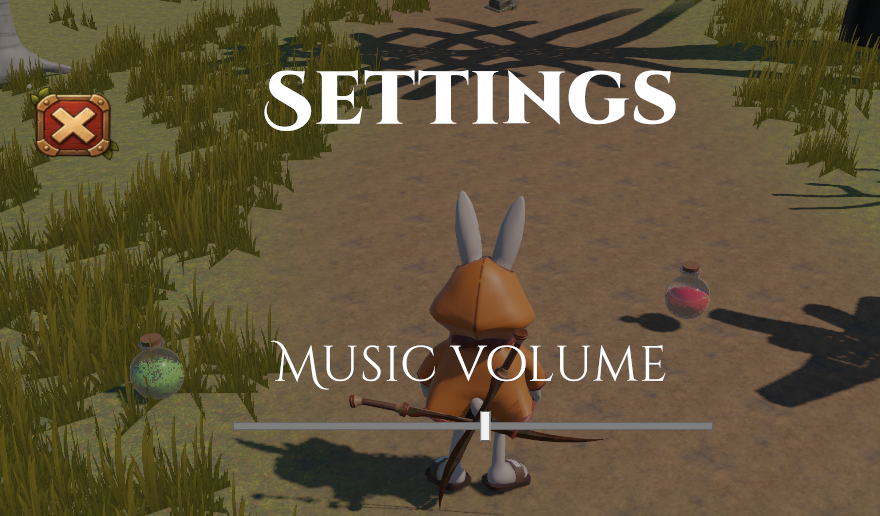
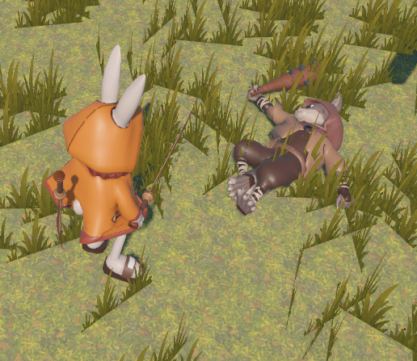

# 🐰 Simply — Action RPG Prototype

A 3D Action RPG prototype developed with **Unity and C#** as a personal game development portfolio project.

Explore the world as a rabbit warrior, fight enemies, chain attacks into combos, collect experience, and manage your health and energy.

> This project represents my progress as a game developer and my experience building gameplay systems from scratch with AI-assisted learning.

## 🎮 Features

- ⚔️ **Combo Combat** — a three-step attack combo system.
- 🐇 **Player Movement** — walking, running, jumping, dashing and other.
- 🐺 **Enemy Combat** — fight wolves and gain experience by defeating them.
- ❤️ **Health System** — manage your health during combat.
- ⚡ **Energy System** — energy management for running and other actions.
- 🧪 **Potions** — consumable items to restore health and energy.
- 🎒 **Inventory & Equipment** — manage items and weapons.
- 🌲 **World Exploration** — explore an environment featuring trees, buildings, and other assets.

## 🖥️ UI & Menus

- Main menu and gameplay entry.
- Dedicated loading screen.
- Pause menu.
- Adjustable music volume.
- Player death screen.

## 🛠️ Built With

- **Unity** — game engine.
- **C#** — gameplay programming.

## 📚 What I Learned

Working on this project helped me practice:

- Organizing gameplay code and separating system responsibilities.
- Implementing player movement and combat mechanics.
- Connecting inventory, equipment, health, energy, and potions.
- Creating enemy interactions and experience rewards.
- Building UI flows and integrating multiple gameplay systems.
- Using AI tools to research unfamiliar concepts and troubleshoot problems.

I made the core design and architectural decisions while using AI as a supporting tool during development. I am continuing to improve my C# skills and become more independent in implementing game systems.

## 🚧 Known Limitations

- No save/load system yet.
- Character models, textures, and environment art need further polish.
- Some gameplay systems and animations could be improved.

## 📸 Screenshots

### Hud & Game

### Combat

### Start Menu

### Pause Menu

### End Menu

### Loading Screen

### Settings

### Enemy Die

## 📦 Download

A playable Windows build will be available in the [Releases](../../releases) section.

## 📌 Project Status

**Status:** Portfolio prototype — core gameplay implemented.

Created for learning and portfolio purposes.

---

Thanks for checking out my project! 🐰⚔️
